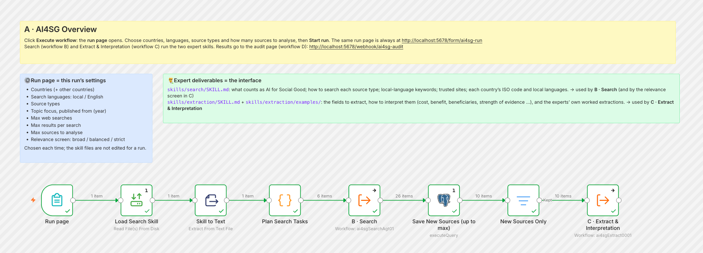
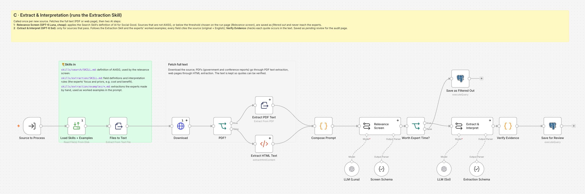
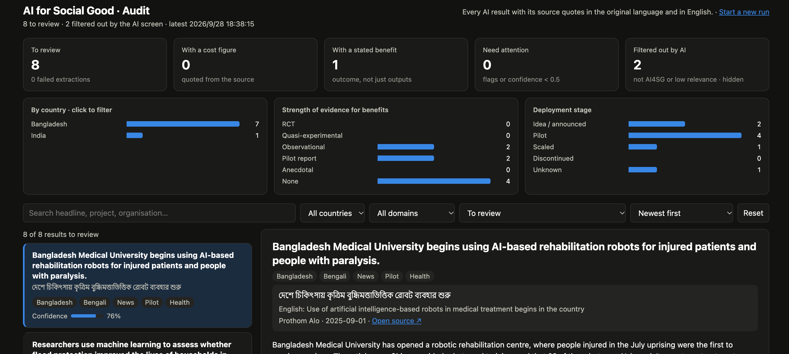

# AI4SG Pipeline · User Guide for Experts

This system searches the web, in local languages and English, for AI for Social Good (AI4SG) projects in
developing countries, then extracts and interprets each source the way you would. You shape it in two ways:
you **write the instructions the AI follows** (two "skill" files plus worked examples), and you **audit its
results** on a web page.

## 1. Access

For now, the system can be tried at **https://gemacbook-air.tail2851f0.ts.net**. It runs on a laptop, so it
is online during agreed trial sessions.

| Page | Address | Used for |
|---|---|---|
| Run page | https://gemacbook-air.tail2851f0.ts.net/form/ai4sg-run | Start a search |
| Audit page | https://gemacbook-air.tail2851f0.ts.net/webhook/ai4sg-audit | Review results |

Both pages use the same login. When the browser shows a small **sign-in window**, enter
username **`ai4sg`** and password **`5c631c7db4b4`**. The browser remembers it.

## 2. How the pipeline works

The pipeline is built in n8n, a visual workflow tool. Each box is one step, and data flows left to right.



1. **Run page → Plan Search Tasks**: each country × language × source type you chose becomes one search
   task, e.g. *Bangladesh × Bengali × News*.
2. **B · Search**: for each task, an AI model (GPT-6 Luna) searches the web following the **Search Skill**,
   opens the pages and PDFs it finds, and returns candidate sources.
3. **Save New Sources**: drops duplicates and anything collected in earlier runs, keeps up to the chosen number.
4. **C · Extract & Interpretation**: runs once for each new source (below).



C downloads the full text of the source, then runs two AI steps. A quick **relevance screen** (GPT-6 Luna)
applies the Search Skill's definition of AI4SG, and sources that fail it are set aside so they never take your
time. Sources that pass go to a detailed **extraction and interpretation** (GPT-6 Sol) that follows the
**Extraction Skill** and your worked examples. Every fact must cite a quote from the source. **Verify
Evidence** then checks by code that each quote really appears in the text.

## 3. Running a search

Open the run page, adjust the settings and click **Start run**. After about 5 to 15 minutes, new results
appear on the audit page. Each run uses paid API credits, so start small (e.g. 6 searches, 10 sources).

| Setting | Meaning |
|---|---|
| Countries / Other countries | Tick focus countries or type others, e.g. `Vietnam, Nepal` |
| Search languages | Local language, English, or both |
| Source types | News, government reports (PDF), government websites, journal papers, conference reports, open-source code & data |
| Topic focus, Published from (year) | Optional, e.g. `flood early warning`, `2022` |
| Max web searches | Upper limit on search tasks (each is one country × language × source type) |
| Max results per search | Candidates returned by each search |
| Max sources to analyse | New sources read in full in this run |
| Relevance screen | How strict the first screen is: Broad 0.4, Balanced 0.6, Strict 0.8 |

## 4. Reviewing results on the audit page



- **Top row and charts**: counts to review, with a cost or benefit, needing attention, filtered out; results
  by country (click to filter), strength of evidence and deployment stage.
- **Filters**: free-text search, country, domain, status and sort order. Status views are *To review*, *Needs
  attention* (warning flags or confidence below 0.5), *No flags*, and *Filtered out by AI (spot-check)*.
- **Detail pane**: click a result to see the English headline, original title with translation, a summary, and
  cards for **Cost, Benefit, Reach and Strength of evidence**. Each card shows whether its quote was verified;
  expand it to see the quote in the original language next to the English translation. **Open source ↗**
  opens the original page.

**Flags**: `quote_not_found` (a quote is not in the source text), `cost_without_evidence` /
`benefit_without_evidence` (a figure with no matching quote), `no_text_extracted` (page or PDF unreadable),
`extraction_failed` (no usable AI result).

Please also open **Filtered out by AI** now and then: if relevant sources appear there, the screen is too
strict or the AI4SG definition in the Search Skill needs refining. The page is read-only for now. Email us
corrections, or better, turn a case you corrected into a worked example (section 5).

## 5. Your inputs: skills and worked examples

A *skill* is a plain-text Markdown file that the AI reads as its instructions, word for word. Your inputs
live in three places:

```
skills/
├── search/SKILL.md        what counts as AI4SG, how to search, local keywords, sites, countries
└── extraction/
    ├── SKILL.md           fields to extract; how to read cost, benefit, evidence; interpretation
    └── examples/          one .md per source you extracted by hand (start from _TEMPLATE.md)
```

- **Editing a skill**: change the text freely; it is written for a human reader as much as for the AI. In
  the Search Skill, keep the `json countries` block valid JSON (add a line there to search a new country in
  its own language). In the Extraction Skill, keep the field names in section 2. If you want a new field,
  let us know so the output format can be extended.
- **Adding worked examples**: copy `_TEMPLATE.md` to a new name such as `bd-rice-disease-app.md` and fill in
  the source excerpt, your extraction and, most usefully, *why you read it that way*. Two to four examples
  covering different source types, with at least one local-language source, teach the model your
  conventions better than more rules. Files whose names start with `_` are not sent to the AI.
- **Submitting**: email us the new or edited files. Once they are placed in these folders, the next run
  uses them; nothing needs restarting.
